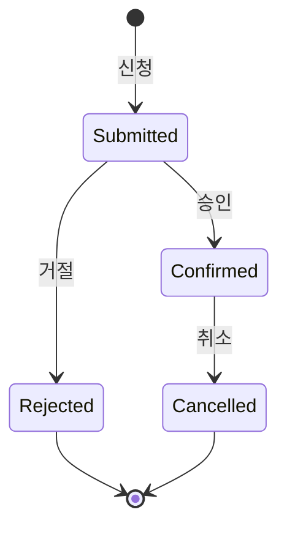

# [Functional Specification] {Feature Name}

> **문서 버전**: 1.0.0 (Final Spec)  
> **기준 feature**: `{feature_name}`  
> **생성 방식**: SDD (Spec Driven Development) 기반 최종 형상 추출  
> **문서 목적**: 본 문서는 시스템 구현 언어나 기술 스택과 무관하게, 해당 Feature가 비즈니스 관점에서 "무엇을", "어떤 규칙과 시나리오로" 수행하는지 정의한 기능 사양서입니다.

---

## 1. Feature 개요 및 도메인 범위 (Scope & Boundary)

### 1.1 배경 및 목적
{이 Feature가 해결하고자 하는 핵심 비즈니스 문제와 달성 목표}

### 1.2 핵심 용어 사전 (Glossary)
| 용어 | 영문 표기 | 정의 및 비즈니스 의미 |
|---|---|---|
| {용어 1} | {Term 1} | {설명} |
| {용어 2} | {Term 2} | {설명} |

### 1.3 시스템 경계 및 책임 (System Boundary)
- **이 Feature가 담당하는 영역**:
  - {예: 예약 슬롯 생성, 정원 차감, 예약 신청/승인/취소 상태 라이프사이클 관리}
- **외부 연동 시스템이 담당하는 영역 (위임)**:
  - {예: 사용자 정의 입력폼 렌더링, 회원 인증, 실 결제 승인 프로세스}

---

## 2. 액터 및 역할 (Actors & Roles)

| 액터 | 역할 및 권한 설명 |
|---|---|
| **관리자 (Admin / AD)** | {예약 폼 설정, 리소스/슬롯 운영 규칙 등록, 예약 건 승인/반려 관리} |
| **사용자 (User / LP)** | {공개 폼 조회, 가용 일정 확인, 예약 신청 및 취소} |
| **시스템 (System / Worker)** | {정원 초과 검증, 일정 마감 자동 처리, 만료 예약 배치} |

---

## 3. 유저 시나리오 및 Use Cases

### UC-01: {유스케이스 명}
- **주요 액터**: {Admin / User}
- **사전 조건 (Pre-conditions)**: {이 유스케이스가 시작되기 전 만족해야 하는 시스템 상태}
- **기본 흐름 (Main Success Scenario)**:
  1. 액터가 ...
  2. 시스템은 ... 을 검증한다.
  3. 액터가 ...
  4. 시스템은 상태를 ... 로 갱신하고 결과를 반환한다.
- **대안 및 예외 흐름 (Alternative / Exception Flows)**:
  - **3-a. {예외 상황}**:
    - 시스템은 작업을 중단하고 `{에러 내용}`을 액터에게 알린다.
- **사후 조건 (Post-conditions)**: {유스케이스 완료 후 시스템 상태 변화 및 발생 이벤트}

---

## 4. 핵심 비즈니스 정책 및 불변식 (Domain Rules & Invariants)

### 4.1 상태 전이 라이프사이클 (State Machine Rules)

- **상태별 규칙**:
  - `{상태 1}`: {설명 및 수정 가능 여부}
  - `{상태 2}`: {설명 및 수정 가능 여부}

### 4.2 슬롯 및 정원/재고 규칙 (Capacity & Availability Rules)
- {예약 가능 시간대(Slot) 격자 생성 및 간격(Interval) 기준}
- {정원(Capacity) 초과 방지 및 동시 신청 시 처리 불변식}

### 4.3 제약 조건 및 예외 정책 (Constraints & Exceptions)
- {마감 시간, 예약 변경 불가 기간, 중복 예약 방지 조건}
