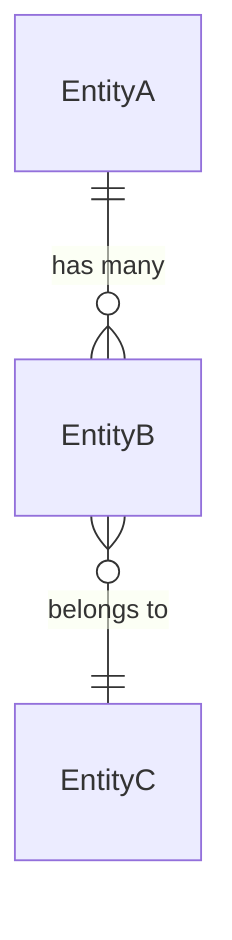

# [Technical Specification] {Feature Name}

> **문서 버전**: 1.0.0 (Final Spec)  
> **기준 프로젝트**: `{project_name}`  
> **생성 방식**: SDD (Spec Driven Development) 기반 최종 형상 추출  
> **문서 목적**: 본 문서는 시스템 구현 언어나 특정 프레임워크(NestJS, Spring, Django 등)에 종속되지 않고, 도메인 데이터 모델, 상태 머신, 인터페이스 계약 및 시스템 연동 규격을 엄밀하게 정의한 기술 사양서입니다.

---

## 1. 논리적 도메인 모델 (Logical Domain Model)

### 1.1 엔티티 정의 (Entities)

#### Entity: `{EntityName}`
- **설명**: {엔티티의 도메인적 역할}
- **필드 명세**:
  | 필드명 | 논리 타입 | 필수 여부 | 고유성(Unique) | 기본값 | 비즈니스 설명 및 제약조건 |
  |---|---|---|---|---|---|
  | `id` | Identifier | Required | Yes | Auto | 고유 식별자 |
  | `status` | Enum | Required | No | 'SUBMITTED' | 라이프사이클 상태 |
  | `{field}` | String / Number / ... | Required / Optional | ... | ... | {설명} |

### 1.2 엔티티 관계도 (Entity Relationships)

- **카디널리티 및 제약**:
  - `EntityA`와 `EntityB`: 1:N 관계. A 삭제 시 B 연쇄 삭제(Cascade) 또는 논리 보존.

---

## 2. 상태 머신 정형 명세 (State Machine Specification)

| 시작 상태 (From) | 이벤트 / 액션 (Trigger) | 가드 조건 (Guard) | 전이 후 상태 (To) | 전이 시 부수 효과 (Side Effects) |
|---|---|---|---|---|
| `SUBMITTED` | `APPROVE` | 관리자 권한 && 정원 가용 | `CONFIRMED` | 확정 알림 발행, 슬롯 확정 카운트 증가 |
| `SUBMITTED` | `REJECT` | 관리자 권한 | `REJECTED` | 거절 사유 기록, 슬롯 예약 가용 반환 |
| `CONFIRMED` | `CANCEL` | 이용 전 취소 마감 시한 이내 | `CANCELLED` | 정원 복원, 취소 일시 기록 |

---

## 3. 인터페이스 & API 계약 (Contract Specification)

> 모든 API는 REST, gRPC, GraphQL 등 프로토콜 구현 방식에 구애받지 않는 계약 형태로 정의합니다.

### 3.1 [명령/조회 이름] (예: `POST /api/v1/bookings`)
- **목적**: {기능 설명}
- **인가(Authorization)**: {Admin / Public / Authenticated User}
- **입력 스키마 (Request Contract)**:
  ```json
  {
    "resourceId": "string (UUID, required)",
    "slotDateTime": "string (ISO8601, required)",
    "headcount": "integer (min: 1, required)",
    "answers": "array of objects (optional)"
  }
  ```
- **유효성 검증 규칙 (Validation Rules)**:
  - `slotDateTime`: 반드시 운영 시간표(Slot Grid)에 포함된 시각이어야 함.
  - `headcount`: 잔여 정원(Capacity) 이하이어야 함.
- **성공 응답 스키마 (Response Contract)**:
  ```json
  {
    "bookingId": "string (UUID)",
    "status": "string (Enum: SUBMITTED | CONFIRMED)",
    "createdAt": "string (ISO8601)"
  }
  ```
- **에러 응답 및 도메인 에러 코드 (Error Contracts)**:
  | 에러 코드 | HTTP 유사 코드 | 발생 상황 |
  |---|---|---|
  | `SLOT_NOT_AVAILABLE` | 409 Conflict | 정원이 마감되었거나 예약 불가 시간 |
  | `INVALID_TIME_INTERVAL`| 400 Bad Request| 격자 단위(Interval)에 맞지 않는 요청 |

---

## 4. 데이터 무결성 및 영속성 요건 (Data Integrity & Storage Rules)

- **식별자 및 고유성 제약(Unique Constraints)**:
  - `{EntityName}`의 `[fieldA, fieldB]` 복합 유니크 제약
- **동시성 제어 요건 (Concurrency Control)**:
  - 잔여 정원 차감 시 Optimistic Lock (버전 컬럼) 또는 DB Level 원자적 업데이트 보장 필수.
- **인덱싱 및 성능 고려사항**:
  - `[tenant_id, target_date, status]` 복합 인덱스 권장.

---

## 5. 외부 시스템 연동 계약 (Integration Contracts & SPI)

### 5.1 연동 시스템 A (예: Collection System)
- **연동 방식**: {동기식 API 호출 또는 비동기 도메인 이벤트}
- **계약 명세**:
  - 발신 이벤트: `{EventName}` (Payload: `{ entityId, timestamp, ... }`)
  - 구독 이벤트: `{ExternalEventName}` (처리: 수신 시 상태 갱신)
